# File Hosting Video Stream

A file hosting & streaming platform built with **Laravel 13** + **Inertia.js** + **Vue 3**.

> ⚠️ **Heavily edited, not production-ready.**
> This project has been extensively customized during iterative development. It is **not
> production-ready**: it is under active development, may contain unfinished features, manual
> database changes, and undocumented behavior. Use at your own risk. A code audit and hardening
> pass (especially validation, authz, CSRF, queue workers, and storage configuration) is strongly
> recommended before any production use.

---

## Overview

FSH Stream lets users upload, organize, share, and stream files (including video). It includes:

- File & directory management (create, rename, move, delete, trash, restore, versions, favorites)
- **File versioning** with per-file history, restore, and rollback
- **Subtitles** (SRT/VTT) per video, with default-track management
- **Batch operations** — upload many files at once and download a ZIP of selected files
- Public links, password-protected links, embeds, and streaming endpoints
- Sharing files & directories with other users (view / download / upload / manage permissions)
- Storage packages & subscriptions/quota per user
- API keys, webhooks (signed), and activity logs
- **Cloud Downloads** — add files from a URL or a torrent (magnet / `.torrent`) directly into
  storage, with live status/progress tracking and **hash-based dedup** (the same bytes are reused
  instantly instead of re-uploading when the checksum already exists)
- Admin panel (users, storage servers, storage packages, downloader clients, logs) under `/admin`
- **System-managed storage pool**: storage servers are selected automatically by the system
  (least-utilized active server), not owned by individual users.

---

## Screenshots

| | |
|---|---|
| **Landing page** | **Login** |
| 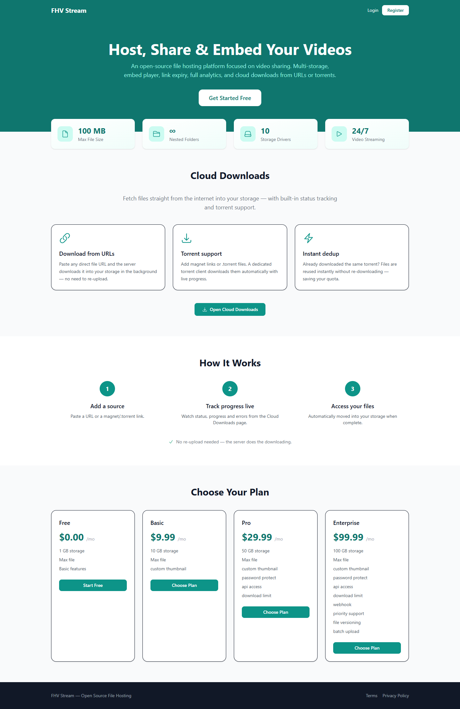 | 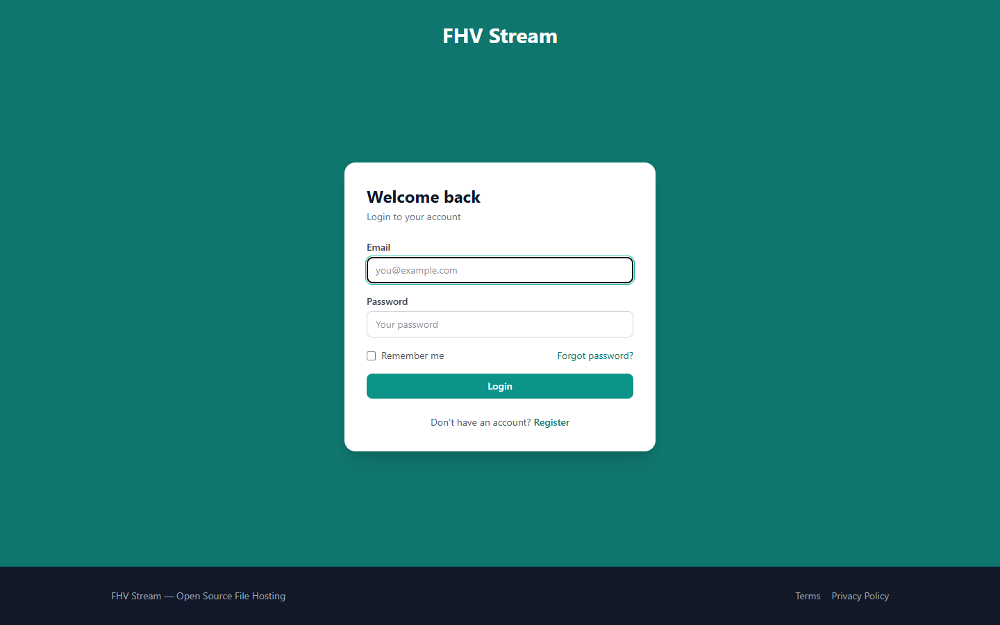 |
| **Register** | **Dashboard** |
| 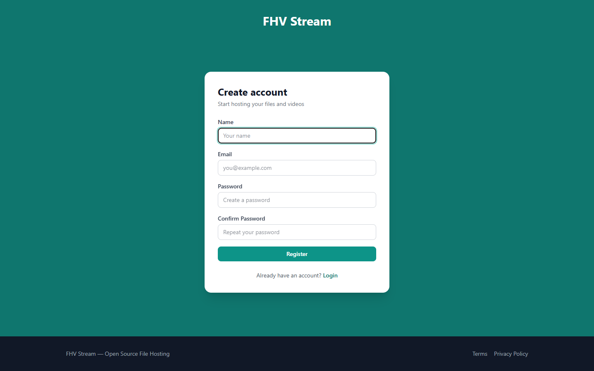 | 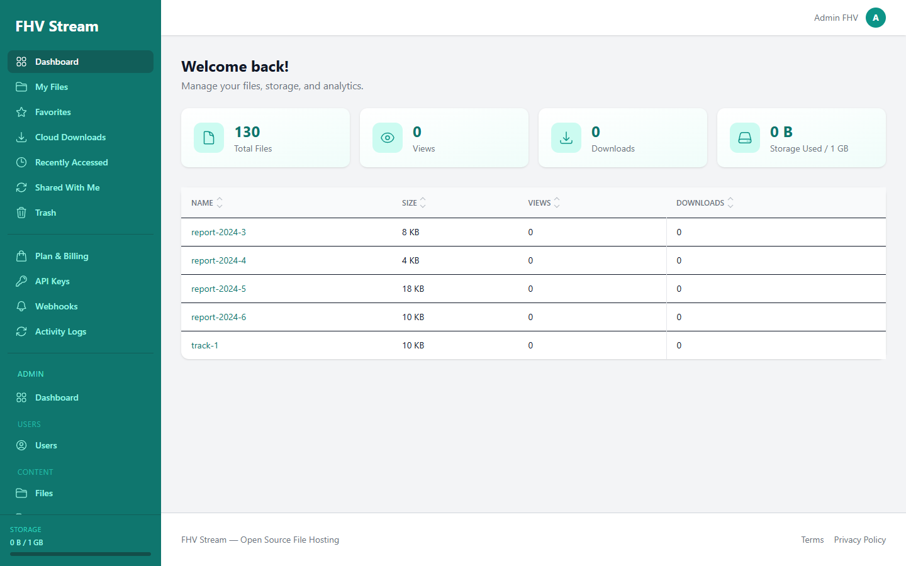 |
| **File manager** | **File player** |
| 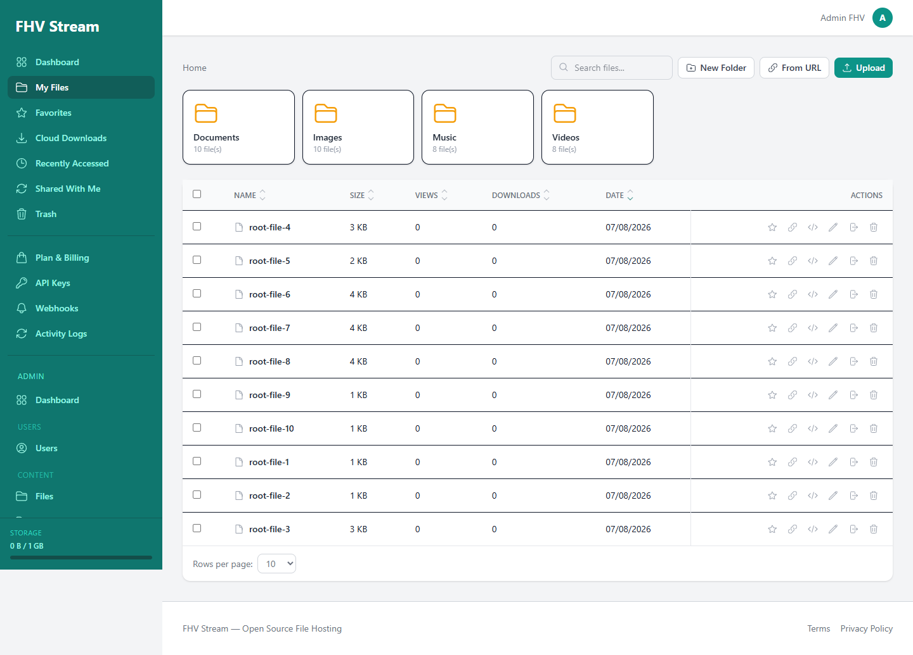 | 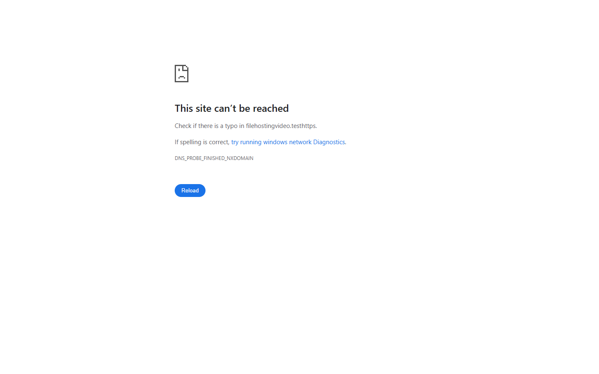 |
| **Cloud Downloads** | **Admin — Users** |
| 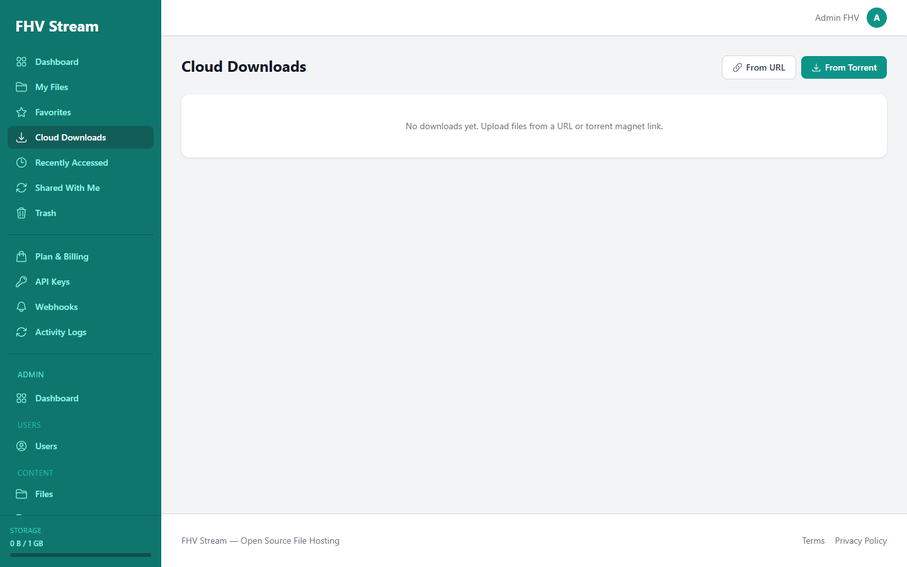 | 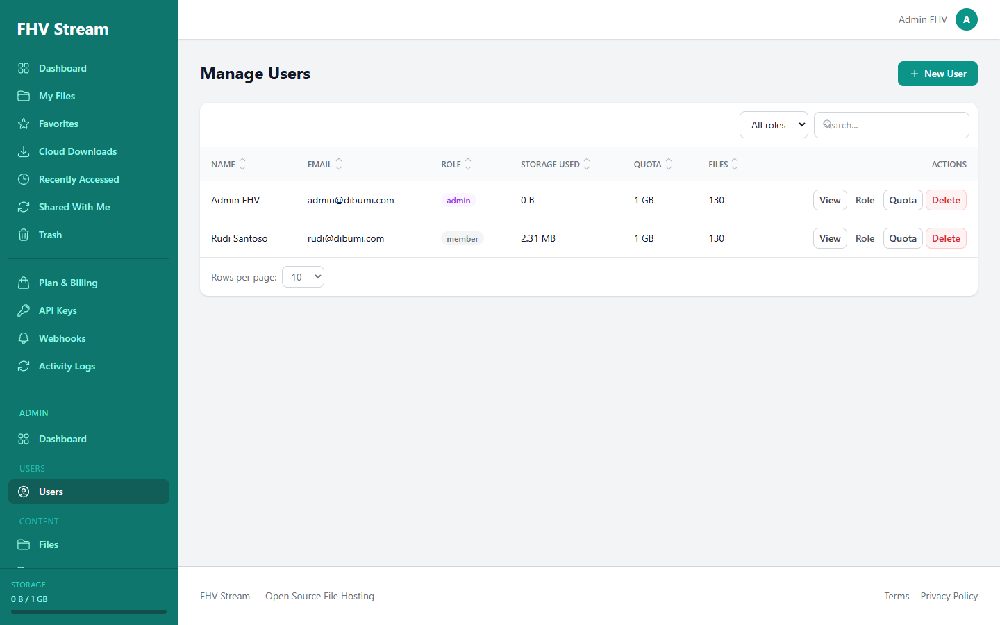 |
| **Admin — Storage** | **Admin — Packages** |
| 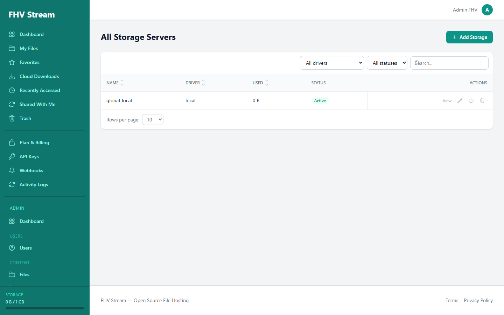 | 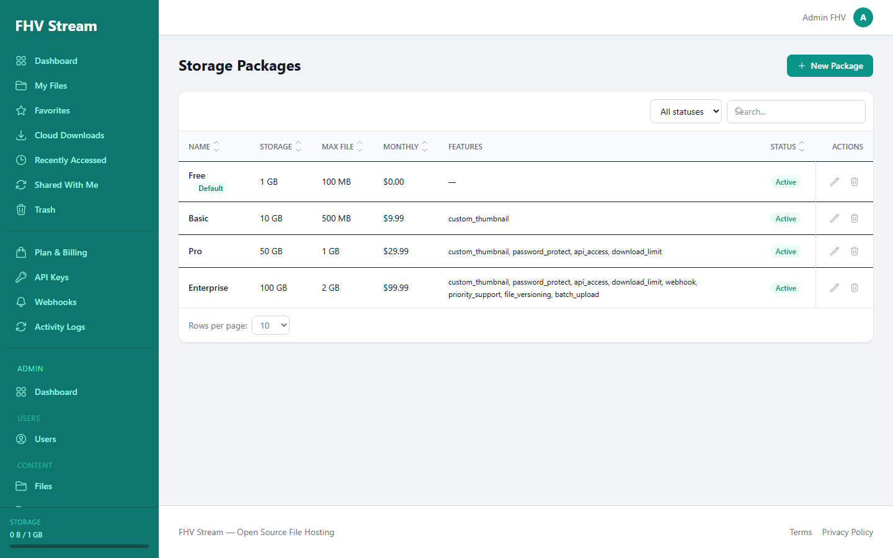 |
| **Admin — Subscriptions** | |
| 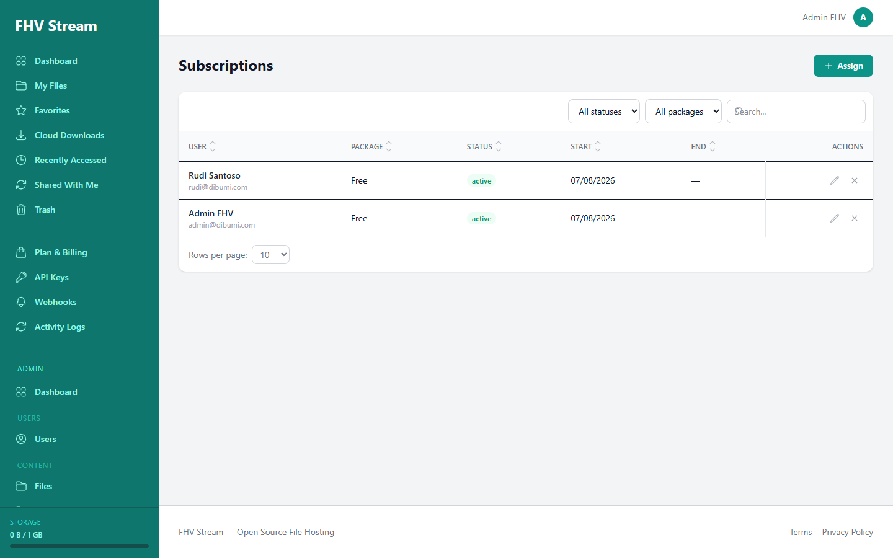 | |

---

## Tech Stack

| Layer | Technology |
|-------|-----------|
| Backend | Laravel 13 (PHP 8.5+) |
| Frontend | Vue 3, Inertia.js v3, Tailwind CSS, Heroicons, Headless UI |
| Media | Spatie Laravel MediaLibrary (local + remote disks) |
| Storage drivers | Local, S3, Wasabi, B2, Azure Blob, GCS, Dropbox, FTP, SFTP, Rackspace |
| Queue | Database driver (`QUEUE_CONNECTION=database`) |
| Auth | Laravel Fortify (sessions, 2FA) |
| Video players | Video.js, Plyr, DPlayer (selectable) |
| Torrent client | Transmission (via `fatkulnurk/torrent` SDK), `.torrent` parsing via `arokettu/bencode` |

### Supported storage drivers

| Driver | Storage backend | Required config fields |
|--------|-----------------|------------------------|
| `local` | Local filesystem | `root` |
| `s3` | Amazon S3 | `key`, `secret`, `region`, `bucket` |
| `wasabi` | Wasabi | `key`, `secret`, `region`, `bucket` |
| `b2` | Backblaze B2 | `key_id`, `application_key`, `bucket` |
| `azure` | Azure Blob Storage | `connection_string`, `container` |
| `gcs` | Google Cloud Storage | `key_file`, `bucket` |
| `dropbox` | Dropbox | `token` |
| `ftp` | FTP Server | `host`, `port`, `username`, `password`, `root` |
| `sftp` | SFTP (SSH) | `host`, `port`, `username`, `password`, `root` |
| `rackspace` | Rackspace Cloud Files | `username`, `api_key`, `container`, `region` |

> Storage servers are configured by an admin in the admin panel (`/admin/storage`). The app then
> auto-registers each server as a Laravel filesystem disk at boot.

> **Storage abstraction:** all storage is built on top of
> [PHPLeague Flysystem](https://flysystem.thephpleague.com/), the same filesystem abstraction Laravel
> uses. This means the app is **not limited to the drivers listed above** — any Flysystem adapter can
> be wired in as a disk, so dozens of backends are theoretically supported (Cloudflare R2, MinIO,
> DigitalOcean Spaces, Contabo, Vultr, GCS, Azure, Wasabi, B2, S3-compatible providers, SFTP, WebDAV,
> FTP, Dropbox, Rackspace, and more).

---

## Requirements

- PHP 8.5+
- Composer
- Node.js & npm
- A MySQL-compatible database (default config points to MySQL `fhv_stream`);
  SQLite is used for unit tests.

> Note: for the async **Cloud Downloads** feature (upload from URL / torrent), a queue worker must
> be running (`php artisan queue:work` / `queue:listen`) and, for torrents, a scheduler
> (`php artisan schedule:work`) — otherwise queued downloads never execute / are never imported.

---

## Installation

```bash
# 1. Install dependencies
composer install
npm install

# 2. Environment
cp .env.example .env
php artisan key:generate

# 3. Database
php artisan migrate --seed

# 4. Frontend (production build or dev server)
npm run build          # production assets
# or
npm run dev            # watch mode (Vite)

# 5. Serve
php artisan serve
# visit http://localhost:8000
```

Herd users can simply open the site through their local domain
(e.g. `https://filehosting-video-stream.test/`) after setting up a site for this directory.

### Queue worker (required for async URL downloads)

```bash
php artisan queue:work   # or queue:listen
```

### Scheduler (required for torrents, trash purge, link expiry, log cleanup)

```bash
php artisan schedule:work
```

Scheduled jobs:

- `SyncStorageStatsJob` — refresh storage usage per server
- `MonitorTorrentDownloadsJob` — poll torrent progress & import finished downloads
- `ImportTorrentFileJob` — import a queued `.torrent` file
- `PurgeTrashJob` — permanently delete trashed files past retention (default 30 days)
- `CleanupExpiredLinksJob` — expire public links / password-protected links
- `CleanupDownloadsJob` / `CleanupOldLogsJob` — prune old tasks & activity logs (default 90 days)
- `ExpireSubscriptionsJob` — mark expired subscriptions

### Torrent server & Cloud Downloads (optional)

Cloud Downloads supports both plain URLs (no external service needed) and **torrents**, which
require a running Transmission server and a scheduler for progress monitoring/import.

1. Configure Transmission (either via `docker compose` or your own instance):
   ```bash
   docker compose up -d transmission
   ```
2. Set environment variables (see `.env.example`):
   ```dotenv
   TRANSMISSION_HOST=http://127.0.0.1
   TRANSMISSION_PORT=9091
   TRANSMISSION_USER=admin
   TRANSMISSION_PASS=
   TORRENT_DOWNLOAD_DIR=
   TORRENT_CONTAINER_DOWNLOAD_DIR=/downloads
   ```
3. Register the downloader client in the admin panel (`/admin/downloaders`) and test the connection.
4. Run the scheduler so torrent progress is polled and completed files are imported:
   ```bash
   php artisan schedule:work
   ```

Torrent files are downloaded into a shared volume, imported into the storage pool (medialibrary),
then the temporary data is removed. When the same torrent info-hash is added again and its files
are still present, they are reused instantly without re-downloading.

---

## Default seeded credentials

> Generated by `DatabaseSeeder` — change these in production!

| Role | Email | Password |
|------|-------|----------|
| Admin | `admin@dibumi.com` | `password` |
| Member | `member@dibumi.com` | `password` |

The seeder also creates:

- A default storage package plan (Free / Basic / Pro).
- A single **global** storage server (`global-local`) used by the whole system.
- **Demo content for both admin and member** (not just the member): a rich nested folder tree
  (~18 folders, 3–4 levels deep) and ~130 files per user across `Videos`, `Images`, `Documents`,
  and `Music` — including subfolders such as `Events/Wedding`, `Tutorials/PHP`, `Reports/2025`,
  and `Music/Playlists`, so you can explore the file manager right away.

---

## Key Concepts

### System-managed storage (global pool)
Uploads do not belong to a per-user storage server. Instead, the app picks an **active** storage
server with the lowest utilization ratio (`storage_used / storage_limit`) at upload time. Manage
storage servers in the admin panel (`/admin/storage`).

### File deduplication
Files are fingerprinted with multiple checksums (CRC32, MD5, SHA-1, SHA-256, SHA-512). When an
upload matches an existing checksum + size, the physical bytes are **reused** (reference-counted)
instead of re-storing them — so uploading the same content again costs nothing. Dedup entries are
cleaned up when the last reference is deleted.

### Storage packages & quota
Each user has a subscription to a storage package, giving them a storage limit and per-file size
limits. Quota is enforced per user; the physical storage is shared globally.

### Sorting & filtering
All index pages (file manager, admin tables, shares, downloads, subscriptions, logs) use a uniform
query format: `sort[field]=asc|desc` (multi-column supported) and `filter[key]=value`. Each page
has a dedicated `{Page}IndexRequest` form request that whitelists sortable fields and strictly
validates filters (enum fields are validated with `Rule::enum`).

### Enums & strict validation
Domain statuses are modeled as backed enums (`Role`, `SubscriptionStatus`, `SharePermission`,
`DownloadTaskStatus`, `DownloadTaskType`, `StorageDriver`, `DownloaderDriver`, `PackageFeature`,
plus admin filter enums). All status/permission/driver form inputs are validated against these
enums — no magic strings.

### Migrations
Migrations are consolidated **by domain** into seven files under `database/migrations`:
`core`, `profile`, `storage`, `file`, `billing`, `integration`, and `download`.

---

## Available Routes (highlights)

### Guest / public
- `GET /` — landing page
- `GET /f/{id}` — public file page (password-protected files require a password)
- `POST /f/{id}/unlock` — unlock a password-protected file (rate-limited)
- `GET /embed/{id}` — embeddable player
- `GET /stream/{id}` — stream endpoint (signed URLs for private files)
- `GET /subtitles/{id}/{media}` — subtitle track (VTT)
- `GET /terms`, `GET /privacy` — legal pages

### Authenticated
- `GET /dashboard` — user dashboard (stats, recent files)
- `GET /files` — file manager (upload, folders, favorites, shares, trash, versions, subtitles)
- `GET /cloud-downloads` — Cloud Downloads (status/progress of URL & torrent downloads)
- `GET /trash` — trashed files (restore / purge)
- `GET /shared-with-me`, `GET /shared-by-me` — file & directory shares
- `GET /recently-accessed`, `GET /favorites`, `GET /activity-logs`
- `GET /api-keys`, `GET /webhooks` (+ webhook logs), `GET /subscriptions`
- `POST /batch/download` — download selected files as a ZIP

### API (`/api/v1/*`, key-authenticated)
- `GET /api/v1/files` — list files
- `POST /api/v1/files` — upload a file
- `GET /api/v1/files/{file}` — file details
- `DELETE /api/v1/files/{file}` — delete a file
- `GET /api/v1/files/{file}/download` — download a file

API keys are sent via the `X-API-Key` header, carry explicit permissions (`file.read`,
`file.write`, `file.delete`) and a per-key rate limit.

### Admin (`/admin/*`)
- `GET /admin/dashboard` — admin dashboard
- `GET /admin/users` — manage users (create, edit, change role, set quota, delete)
- `GET /admin/files` — manage all files (filter by owner/status/type)
- `GET /admin/directories` — manage all directories
- `GET /admin/packages` — manage storage packages
- `GET /admin/storage` — manage storage servers (drivers, config, deactivate/migrate)
- `GET /admin/downloaders` — manage downloader clients (URL / torrent / Transmission)
- `GET /admin/subscriptions` — manage subscriptions
- `GET /admin/logs` — global activity logs

---

## Security notes

- **Ownership checks**: file/directory/share/task access is scoped to the owner (or an active share)
  in the service layer; admin routes are guarded by an `admin` middleware.
- **Streaming**: private files require a signed, expiring URL; public files are streamable directly.
  Password-protected public files require the unlock session before streaming/subtitles are served.
- **SSRF guards**: the "download from URL" feature rejects private/loopback/reserved hosts and
  re-checks the final host after redirects at execution time; webhook URLs are validated against
  the same private-host blocklist and re-checked when the job runs.
- **Input validation**: all inputs go through dedicated Form Requests; enum columns use `Rule::enum`.
- **Brute-force hardening**: public file unlock is rate-limited; file/share passwords require a
  minimum of 8 characters.
- **Header injection**: user-supplied file names are sanitized before being placed in
  `Content-Disposition` headers.

---

## Tests

```bash
php artisan test
```

79 tests / 166 assertions currently passing. Covers:

- Auth/admin access control (`AdminAccessTest`)
- Cloud downloads & torrent jobs (`DownloadTest`, `DownloadJobTest`, `AdminDownloaderTest`)
- Streaming & signed URLs (`StreamAccessTest`), subtitles (`SubtitleTest`)
- Exception rendering (`ExceptionRenderingTest`)
- Strict enum validation & sorting/filtering (`StrictEnumValidationTest`)
- Security hardening (`SecurityFixTest`): password-protected streams, webhook SSRF, password
  minimums, unlock throttling, signed stream URLs, header sanitization
- Auth feedback (`AuthFeedbackTest`): login/register errors, anti-enumeration password reset

---

## Notes & Caveats

- **Not production ready.** No load-testing, hardening, or full E2E coverage.
- Storage drivers may require environment credentials (S3, Azure, etc.) not included in `.env.example`.
- The Cloud Downloads feature fetches remote content server-side (with SSRF guards on built-in
  private/blocked hosts) and downloads torrents via a Transmission client. Both should be reviewed
  carefully for abuse (queue load, SSRF edge cases, redirects, quota, legal use of torrents) before
  enabling widely.
- Webhook delivery performs an outbound HTTP request to user-supplied URLs. Hosts are validated
  against a private/blocked blocklist at create time and again when the job runs, but allowlisting
  delivery targets is recommended for stricter environments.

---

## Contributing

This is a private/experimental project. Contributions and suggestions are welcome but should be
coordinated with the repository owner.

## License

This project is open-sourced software licensed under the [MIT license](LICENSE).
The Laravel framework is open-sourced software licensed under the [MIT license](https://opensource.org/licenses/MIT).
